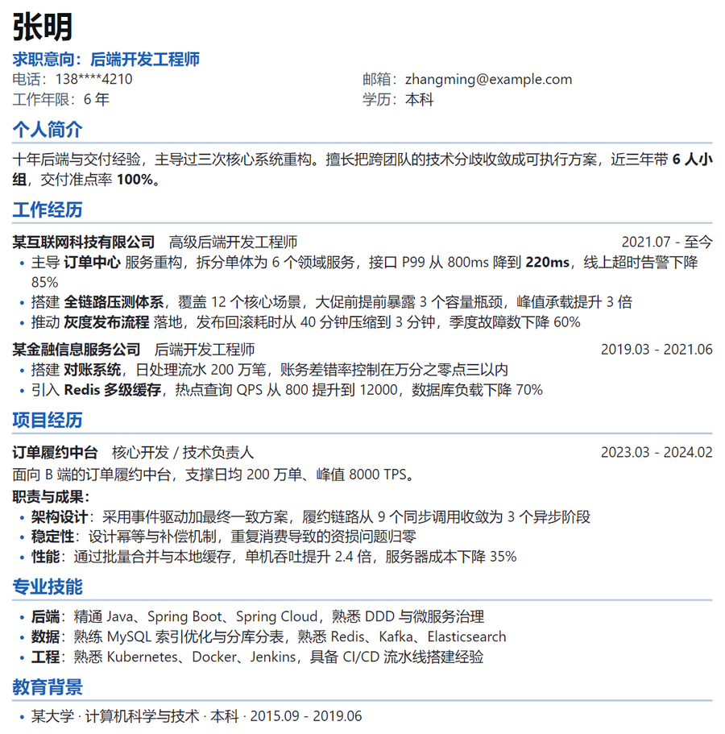
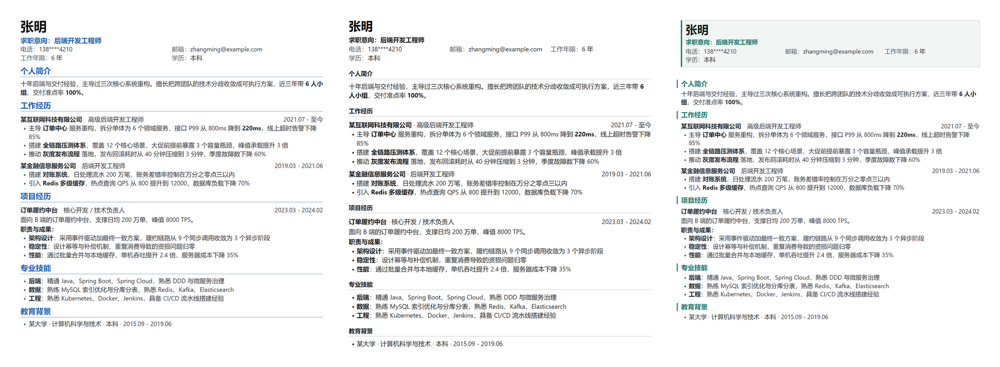
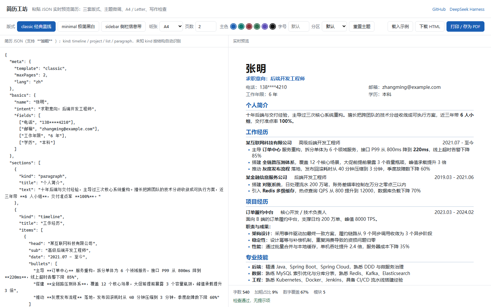

<div align="center">



# dsh-resume-studio

Generates a resume as HTML, Word and PDF from a single JSON file, and checks the writing.

[](LICENSE)
[](package.json)
[](tests)
[](#layouts-and-theme)
[](#data-format)
[](#paper-and-language)
[](#paper-and-language)

[简体中文](README.md) | English

[Open the playground](https://zwh0714.github.io/dsh-resume-studio/) (no installation)

</div>

---

<p align="center">
  
</p>

<p align="center"><sub>Left: classic (banking / public sector / manufacturing) · Middle: minimal (consulting / academia / overseas) · Right: sidebar (tech / product)</sub></p>

---

## Features

- **A single source for both exports**: the DOCX is the master and the PDF is converted from it, so the two paginate identically
- **The page limit is enforced**: given `maxPages`, it tightens line spacing and re-typesets; when it cannot converge, it reports what to cut
- **Writing checks**: number coverage, bold density, entry length, date format, section count, page count
- **Configurable appearance**: three presets, adjustable through `meta.theme` (accent colour, font size, line height, section style) without writing CSS
- **Four section kinds**: `timeline`, `project`, `list`, `paragraph`; section titles are free-form
- **A4 or Letter, Chinese or English**

## Try it first

You can see the output without installing anything. Open the
[playground](https://zwh0714.github.io/dsh-resume-studio/), edit the JSON on the left, and the A4 preview
and writing checks update on the right.

<p align="center">
  
</p>

The playground and the CLI share the same renderer; `tools/verify-playground.mjs` checks that both produce
byte-identical output.

---

## Install

Requires Node.js ≥ 20. PDF output needs a LibreOffice installation, described in
[the two PDF engines](#the-two-pdf-engines); without one, HTML and Word are still produced.

### Option A: as a DSH plugin

GUI: Plugins → Add plugin → paste the repository URL → install.

```
https://github.com/zwh0714/dsh-resume-studio
```

Command line:

```powershell
dsh plugin add github:zwh0714/dsh-resume-studio
```

Pin a version: `dsh plugin add github:zwh0714/dsh-resume-studio#v0.5.0`

Fully quit and restart DSH after installing; six tools then appear in the conversation.

### Option B: standalone CLI (DSH not required)

```bash
npx dsh-resume-studio init --out resume.json --lang en
npx dsh-resume-studio render --in resume.json --out out
```

### Option C: local directory (edits take effect immediately)

```powershell
dsh plugin add file:E:\dsh-resume
```

---

## Usage

Tool names do not need to be memorised. Describe the task in plain language:

| Input | What the agent does |
|---|---|
| Write me a resume for a technical PM role | Reads the flow from `resume_guide`, interviews in three rounds, builds the JSON, exports all three formats |
| Here is my old resume; retarget it at a delivery lead role | Reads the existing content, reorders sections, rephrases for the new role |
| Here is the JD: (full text). Rewrite for it, keep it to 2 pages | Analyses the JD, adjusts emphasis, uses `maxPages` to fit 2 pages |
| Do it in English for an overseas role | Switches to `lang: en`; field labels and section titles follow |
| Re-render with the sidebar layout, PDF only | Changes layout and output formats |

Page count, layout and format can also be stated directly in the conversation:

- Page count: `keep it to 2 pages` / `squeeze it onto 1 page`
- Layout: `classic` / `minimal` / `sidebar`, or all three at once for comparison
- Format: `PDF and Word` / `PDF only`

Output files are named `<Name>-Resume.*` in English and `<姓名>-简历.*` in Chinese.

### Tools

| Tool | Purpose | Required argument |
|---|---|---|
| `resume_guide` | Interview flow, writing and bold rules; `topic` selects one section | — |
| `resume_init` | Writes a JSON skeleton (accepts `lang` / `pageSize`) | `outPath` |
| `resume_import` | Reads an existing `.doc` / `.docx` / `.odt` into plain text | `inputPath` |
| `resume_render` | Renders HTML / DOCX / PDF and fits `maxPages` | `dataPath` |
| `resume_check` | Reports number coverage, bold density, entry length, page count | `dataPath` |
| `resume_templates` | Lists the three presets | — |

---

## Paper and language

Both settings live in `meta` and are also available as CLI flags:

| Requirement | JSON | Command line |
|---|---|---|
| US applications | `"pageSize": "Letter"` | `init --page-size Letter` |
| China or Europe | `"pageSize": "A4"` (default) | — |
| English resume | `"lang": "en"` | `init --lang en` |

`lang` also switches the skeleton field labels, section titles, `<html lang>`, the document title,
half-width versus full-width colons, the page-number footer (`第 1 页` / `Page 1`), and the check rules:
an English resume using `Present`, `Education` or `Phone:` is no longer reported incorrectly.

Fonts use a cross-platform fallback chain (`Microsoft YaHei → PingFang SC → Noto Sans CJK SC → …`),
so the layout does not degrade on macOS or Linux when a font is missing. To change the body font,
set `"font": "Noto Serif SC"`.

---

## Layouts and theme

| id | Look | Fits |
|---|---|---|
| `classic` | Navy section rules, single column, two-column contact block | Banking, public sector, manufacturing, project management |
| `minimal` | No colour, hairline rules, three-column contact block, tracked titles | Consulting, academia, overseas applications |
| `sidebar` | Tinted header band, left rule per section, page numbers | Tech, product |

The presets only supply defaults. To adjust appearance, use `meta.theme`; no CSS is required:

```json
"meta": {
  "template": "classic",
  "theme": {
    "accent": "#0F766E",
    "bodySize": 11,
    "lineHeight": 1.02,
    "sectionStyle": "bar"
  }
}
```

| Key | Effect |
|---|---|
| `accent` | Section titles, bullet markers, rules and the target-role line |
| `text` / `muted` / `band` / `rule` / `name` | Body colour, secondary text, header band, dividers, name colour |
| `font` | Body font (same as `meta.font`) |
| `bodySize` | Body size, 8–16pt; all other sizes and the line height scale by the same ratio, so the page count does not jump |
| `lineHeight` | Line spacing multiplier, 0.85–1.6 |
| `sectionStyle` | `rule` underline / `tracked` tracked rule / `bar` left bar |

Invalid values are dropped and fall back to the preset; they never interrupt rendering.

---

## Data format

```json
{
  "meta": { "template": "classic", "maxPages": 2, "lang": "en", "pageSize": "A4" },
  "basics": {
    "name": "Your Name",
    "intent": "Target role: Backend Engineer",
    "fields": [["Phone", "+1 555 000 0000"], ["Email", "you@example.com"]]
  },
  "sections": [
    {
      "kind": "paragraph",
      "title": "Summary",
      "text": "One coherent paragraph. Mark emphasis with **double asterisks**; blank lines split paragraphs."
    },
    {
      "kind": "timeline",
      "title": "Experience",
      "items": [{ "head": "Company", "sub": "Title", "date": "2022.04 - Present",
                  "bullets": ["Verb **key noun**, with one verifiable number."] }]
    },
    { "kind": "list", "title": "Skills", "bullets": ["**Category:** tools and technologies"] }
  ]
}
```

- `**double asterisks**` marks bold; HTML and Word parse the same syntax
- There are four kinds:

  | kind | Structure | Use for |
  |---|---|---|
  | `timeline` | `items` (head / sub / date / bullets) | Experience, education |
  | `project` | Same, with optional `intro` and `label` | Projects |
  | `list` | `bullets` | Skills, awards, certificates, publications |
  | `paragraph` | `text`, blank lines split paragraphs | Summary, profile |

- Section titles are free-form ("Publications", "Awards", "Open source"); only the structure matters.
  If `kind` holds any other value, the structure is inferred from the fields, and the check reports
  which structure was used at `info` level
- `resume_init` writes a fillable skeleton
- Full examples: [`examples/en-frontend.json`](examples/en-frontend.json), [`examples/zh-backend.json`](examples/zh-backend.json)

---

## Automatic page fitting

`maxPages` is enforced. When the output is too long, the following loop runs for up to 7 rounds:

```
render DOCX → convert to PDF → read the page count → if over, line spacing −1.5% → retry
```

When it cannot converge, the result reports the current line spacing, the lines a page can hold,
how many lines must go, the largest section, the three heaviest entries, and the suggested order of cuts.

---

## Writing checks

| Rule | Level | Meaning |
|---|---|---|
| `contact` | error | Phone or email missing; recognised from either the label or the value, in both languages |
| `pages` | error | Exceeds `maxPages` |
| `numbers` | warn | Claims a change without a number; summarised when coverage is below 50% |
| `density` | warn | An entry longer than 110 characters |
| `bold` | warn | Bold characters exceed 25% |
| `structure` | warn | Fewer than 3 or more than 6 sections |
| `verbs` | info | Opens with a weak verb ("responsible for", "assisted"), in either language |
| `date` | info | Inconsistent date format; `Present` and `至今` are both accepted |
| `kind` | info | Unrecognised section `kind`, with the structure that was used instead |

---

## The two PDF engines

The plugin selects an engine automatically: the LibreOffice Kit bundled with DSH first, because it paginates
closest to Word, then a system LibreOffice installation.

| Environment | Engine | PDF |
|---|---|---|
| DSH installed | LibreOffice Kit | Produced; pagination closest to Word |
| Only LibreOffice | `soffice` | Produced |
| Neither | — | HTML and Word only; the HTML includes print styles, so a browser can print it to PDF |

Override with `DSH_LO_CLI` / `DSH_LO_NODE` (Kit) or `RESUME_SOFFICE` (path to the system binary).
To see which engine is in use: `npx dsh-resume-studio engine`

Known limits: Word and LibreOffice pagination differ by ±1–3%, so the target is "not more than N pages"
rather than exact line placement; fonts are not embedded, so send the PDF when the recipient may lack the font.

---

## Development

```bash
npm install
npm test           # 88 tests; PDF integration tests skip automatically when no engine is available
npm run test:pdf   # PDF end-to-end only (needs an engine)
npm run build:site # rebuild the docs/ playground and verify it matches the Node renderer
```

Pushing a `v*` tag runs the tests, packs the package and creates a Release; see `.github/workflows/release.yml`.

The previews in `docs/*.png` are produced by rendering `examples/zh-backend.json` to DOCX and converting it
through LibreOffice.

---

## License

MIT

---

The playground is served by GitHub Pages from the `/docs` directory: Settings → Pages → Source →
`Deploy from a branch`, folder `/docs`.
