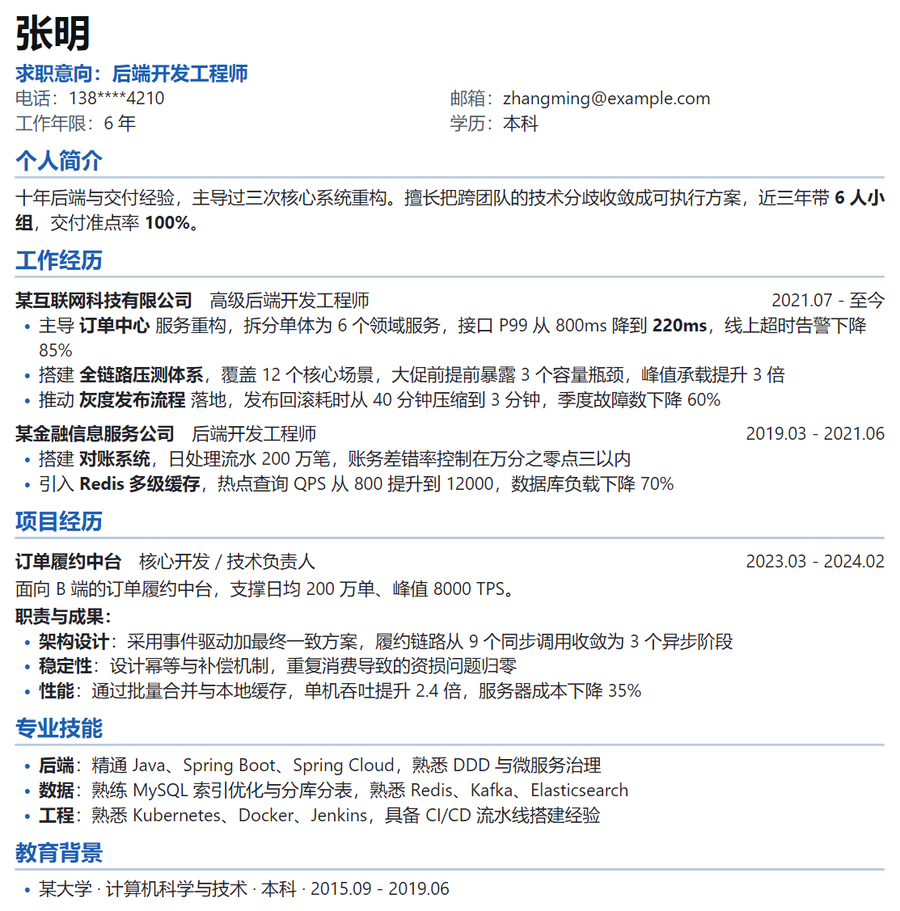
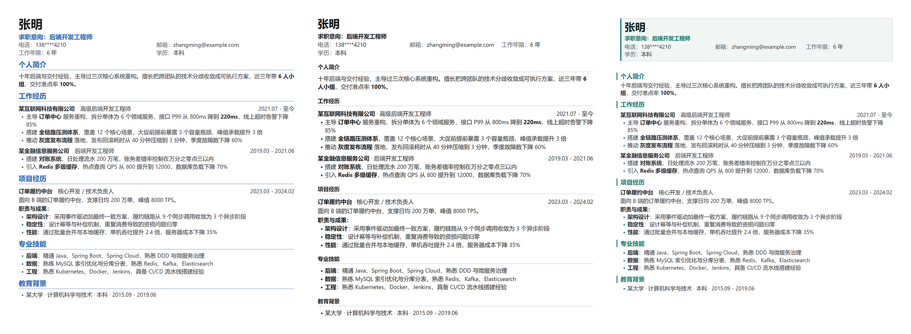
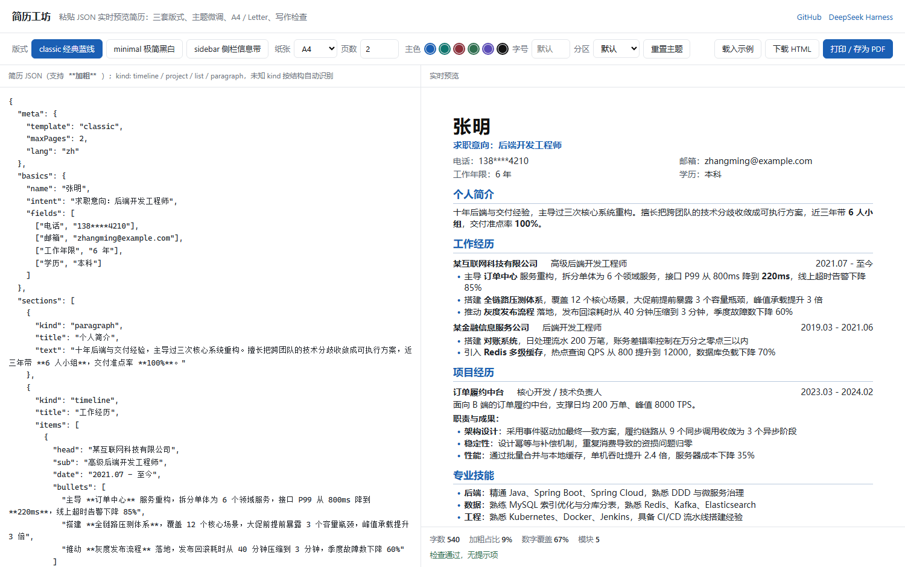

<div align="center">



# dsh-resume-studio · 简历工坊

从一份 JSON 生成 HTML、Word、PDF 三种格式的简历，并检查写作质量。

[](LICENSE)
[](package.json)
[](tests)
[](#版式与主题)
[](#数据格式)
[](#纸张与语言)
[](#纸张与语言)

简体中文 | [English](README.en.md)

[在线试用，无需安装](https://zwh0714.github.io/dsh-resume-studio/)

</div>

---

<p align="center">
  
</p>

<p align="center"><sub>左：classic（银行 / 国企 / 制造）　中：minimal（外企 / 咨询 / 海外）　右：sidebar（互联网 / 产品 / 技术）</sub></p>

---

## 功能

- **导出同源**：Word 是母版，PDF 由它转换，两种格式的分页一致
- **页数上限是硬约束**：给定 `maxPages` 后自动收紧行距并重排；收敛不了时给出可执行的删减建议
- **内容检查**：数字覆盖、加粗占比、条目长度、时间格式、模块数量、总页数
- **外观可配置**：三套预设，可用 `meta.theme` 调整主色、字号、行高与分区样式，不需要写 CSS
- **四种模块形态**：`timeline` / `project` / `list` / `paragraph`，模块标题可以自定义
- **A4 与 Letter，中文与英文**

## 在线试用

不安装也可以先看输出：打开[在线试用页](https://zwh0714.github.io/dsh-resume-studio/)，
左侧编辑 JSON，右侧实时渲染 A4 预览，底部显示检查结果。

<p align="center">
  
</p>

试用页与 CLI 使用同一套渲染代码，`tools/verify-playground.mjs` 校验两者输出逐字节一致。

---

## 安装

要求 Node.js ≥ 20。生成 PDF 需要一个 LibreOffice，详见 [PDF 的两种引擎](#pdf-的两种引擎)；
没有时仍可输出 HTML 与 Word。

### 方式 A：作为 DSH 插件

图形界面：左侧「插件」→ 右上「添加插件」→ 粘贴仓库地址 → 安装

```
https://github.com/zwh0714/dsh-resume-studio
```

命令行：

```powershell
dsh plugin add github:zwh0714/dsh-resume-studio
```

固定版本：`dsh plugin add github:zwh0714/dsh-resume-studio#v0.5.0`

安装后需完全退出并重新启动 DSH，对话中会出现六个工具。

### 方式 B：独立 CLI（不需要 DSH）

```bash
npx dsh-resume-studio init --out resume.json --lang zh
npx dsh-resume-studio render --in resume.json --out out
```

### 方式 C：本地目录（修改代码立即生效）

```powershell
dsh plugin add file:E:\dsh-resume
```

---

## 使用

不需要记工具名，直接用自然语言描述需求：

| 输入 | Agent 的处理 |
|---|---|
| 帮我写份简历，投技术项目经理 | 读取 `resume_guide` 的流程，分三轮访谈，生成 JSON 后导出三种格式 |
| 这是我的旧简历，帮我改成投交付负责人 | 读取旧内容，重排模块，按新岗位调整措辞 |
| 这是 JD：（全文）。按它改，保持 2 页 | 分析 JD，调整侧重点，用 `maxPages` 压到 2 页 |
| 用英文写，投海外的岗位 | 切换到 `lang: en`，字段名与模块标题改为英文 |
| 用 sidebar 版式重出一版，只要 PDF | 更换版式与输出格式 |

页数、版式与格式都可以在对话里直接指定：

- 页数：`最多 2 页` / `压到 1 页`
- 版式：`classic` / `minimal` / `sidebar`，可以一次生成三套对比
- 格式：`PDF 和 Word 都要` / `只要 PDF`

产物命名规则：`<姓名>-简历.html/.docx/.pdf`；英文简历为 `<Name>-Resume.*`。

### 工具列表

| 工具 | 作用 | 必填参数 |
|---|---|---|
| `resume_guide` | 返回访谈流程、写作与加粗规则；`topic` 可取单节 | — |
| `resume_init` | 生成 JSON 骨架（可指定 `lang` / `pageSize`） | `outPath` |
| `resume_import` | 读取旧简历 `.doc/.docx/.odt` 并转为纯文本 | `inputPath` |
| `resume_render` | 输出 HTML / DOCX / PDF，按 `maxPages` 自动压页 | `dataPath` |
| `resume_check` | 检查数字覆盖、加粗占比、条目长度与页数 | `dataPath` |
| `resume_templates` | 列出三套预设 | — |

---

## 纸张与语言

两个开关都放在 `meta` 里，命令行也支持：

| 场景 | JSON | 命令行 |
|---|---|---|
| 投北美 | `"pageSize": "Letter"` | `init --page-size Letter` |
| 投国内或欧洲 | `"pageSize": "A4"`（默认） | — |
| 英文简历 | `"lang": "en"` | `init --lang en` |

`lang` 会一并切换骨架字段名、模块标题、`<html lang>`、文档标题、冒号的半角/全角、页码文案
（`第 1 页` / `Page 1`），以及检查规则：英文简历使用 `Present`、`Education`、`Phone:` 时不再误报。

字体默认使用跨平台回退链（`Microsoft YaHei → PingFang SC → Noto Sans CJK SC → …`），
在 macOS 与 Linux 上不会因缺字体而改变排版。更换正文字体：`"font": "Noto Serif SC"`。

---

## 版式与主题

| id | 观感 | 适合 |
|---|---|---|
| `classic` 经典蓝线 | 深蓝分区线、单栏、信息两列 | 银行 / 国企 / 制造 / 项目经理 |
| `minimal` 极简黑白 | 无彩色、细线、三列信息、字距标题 | 外企 / 咨询 / 学术 / 海外投递 |
| `sidebar` 侧栏信息带 | 灰底信息带、左侧竖线、页码 | 互联网 / 产品 / 技术 |

预设只提供默认值。需要在预设基础上调整外观时，使用 `meta.theme`，无需编写 CSS：

```json
"meta": {
  "template": "classic",
  "theme": {
    "accent": "#0F766E",
    "bodySize": 11,
    "lineHeight": 1.02,
    "sectionStyle": "bar"
  }
}
```

| 键 | 作用 |
|---|---|
| `accent` | 分区标题、圆点、竖线、意向行的主色 |
| `text` / `muted` / `band` / `rule` / `name` | 正文色、次要信息色、信息带底色、分隔线色、姓名色 |
| `font` | 正文字体（等同于 `meta.font`） |
| `bodySize` | 正文字号，取值 8–16pt；其余字号与行高按同一比例缩放，避免页数激增 |
| `lineHeight` | 行距倍数，取值 0.85–1.6 |
| `sectionStyle` | `rule` 下划线 / `tracked` 字距线 / `bar` 竖线 |

取值非法的项会被丢弃并回落到预设值，不会中断渲染。

---

## 数据格式

```json
{
  "meta": { "template": "classic", "maxPages": 2, "lang": "zh", "pageSize": "A4" },
  "basics": {
    "name": "你的姓名",
    "intent": "求职意向：目标岗位",
    "fields": [["电话", "13800000000"], ["邮箱", "you@example.com"]]
  },
  "sections": [
    {
      "kind": "paragraph",
      "title": "个人简介",
      "text": "一段连贯的话。需要强调的部分用 **双星号** 标记，空行分段。"
    },
    {
      "kind": "timeline",
      "title": "工作经历",
      "items": [{ "head": "公司名称", "sub": "职位", "date": "2022.04 - 至今",
                  "bullets": ["动词 **关键名词**，带一个可验证的结果数字。"] }]
    },
    { "kind": "list", "title": "专业技能", "bullets": ["**分类：**掌握的技术与工具"] }
  ]
}
```

- `**双星号**` 表示加粗，HTML 与 Word 解析同一套标记
- `kind` 有四种：

  | kind | 结构 | 适合 |
  |---|---|---|
  | `timeline` | `items`（head / sub / date / bullets） | 工作经历、教育背景 |
  | `project` | 同上，可另带 `intro` 与 `label` | 项目经历 |
  | `list` | `bullets` | 技能、获奖、证书、发表文章 |
  | `paragraph` | `text`，空行分段 | 个人简介、自我评价 |

- 模块标题可以自定义（如「发表文章」「获奖」「开源项目」），只需选对结构。
  若 `kind` 写了其他值，会按字段结构推断，并在检查结果中以 `info` 级别说明按哪种结构处理
- `resume_init` 可以直接生成一份可填的骨架
- 完整示例：[`examples/zh-backend.json`](examples/zh-backend.json)、[`examples/en-frontend.json`](examples/en-frontend.json)

---

## 自动压页

`maxPages` 为硬约束，超出时执行以下循环，最多 7 轮：

```
渲染 DOCX → 转 PDF → 回读页数 → 超页则行距 −1.5% → 重试
```

收敛失败时，输出会给出当前行距、每页可容纳行数、还差多少行、篇幅最大的模块、
最占篇幅的三个条目，以及建议的处理顺序，便于判断从哪里删减。

---

## 内容检查

| 规则 | 级别 | 说明 |
|---|---|---|
| `contact` | error | 缺少电话或邮箱；中英文标签或字段值均可识别 |
| `pages` | error | 超过 `maxPages` |
| `numbers` | warn | 描述中声称变化但未给出数字；全篇覆盖率低于 50% 时汇总提示 |
| `density` | warn | 单条超过 110 字 |
| `bold` | warn | 加粗字符占比超过 25% |
| `structure` | warn | 模块数少于 3 或多于 6 |
| `verbs` | info | 以「负责 / 参与 / 协助」开头；英文对应弱动词同样提示 |
| `date` | info | 时间格式不统一；`至今` 与 `Present` 均视为合法 |
| `kind` | info | 模块 `kind` 无法识别时，说明按哪种结构渲染 |

---

## PDF 的两种引擎

插件自动选择转换引擎，优先使用 DSH 自带的 LibreOffice Kit（与 Word 分页最接近），
其次使用系统安装的 LibreOffice：

| 环境 | 引擎 | PDF |
|---|---|---|
| 已安装 DSH | LibreOffice Kit | 可生成，分页与 Word 最接近 |
| 只安装 LibreOffice | `soffice` | 可生成 |
| 两者都没有 | — | 只输出 HTML 与 Word；HTML 内含打印样式，可用浏览器打印为 PDF |

手动指定：`DSH_LO_CLI` / `DSH_LO_NODE`（Kit），或 `RESUME_SOFFICE`（系统 soffice 路径）。
查看当前使用的引擎：`npx dsh-resume-studio engine`

已知限制：Word 与 LibreOffice 的分页存在 ±1–3% 差异，因此以「不超过 N 页」为目标，不保证精确到行；
字体不嵌入，跨机器投递时建议直接发送 PDF。

---

## 开发

```bash
npm install
npm test           # 88 个测试；PDF 集成测试在没有引擎时自动跳过
npm run test:pdf   # 只运行 PDF 端到端测试（需要引擎）
npm run build:site # 重新构建 docs/ 的在线试用页，并校验与 Node 输出一致
```

推送 `v*` 标签会触发测试、打包并创建 Release，见 `.github/workflows/release.yml`。

预览图（`docs/*.png`）由 `examples/zh-backend.json` 渲染成 DOCX 后经 LibreOffice 转图生成。

---

## License

MIT

---

在线试用页由 GitHub Pages 从 `/docs` 目录提供：Settings → Pages → Source 选择
`Deploy from a branch`，目录选择 `/docs`。
